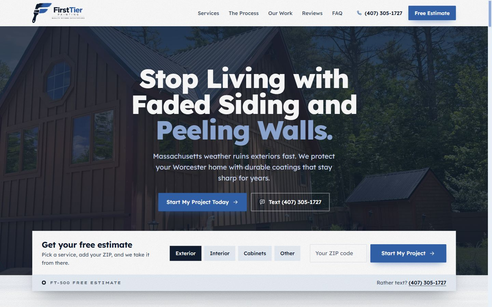
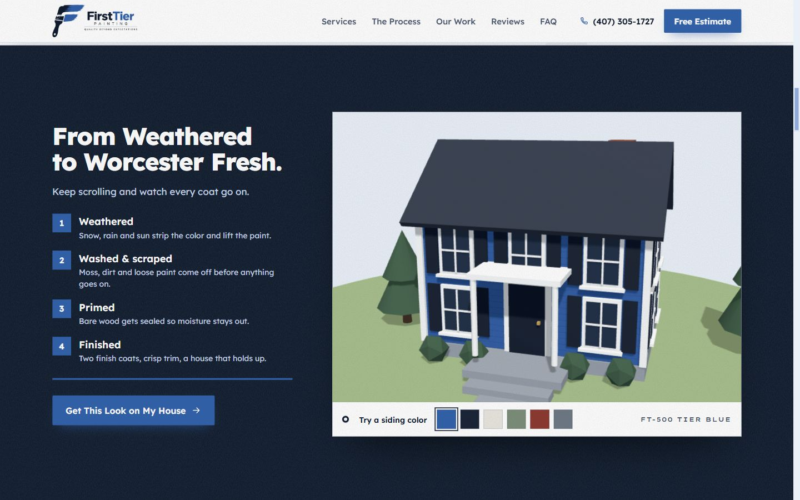
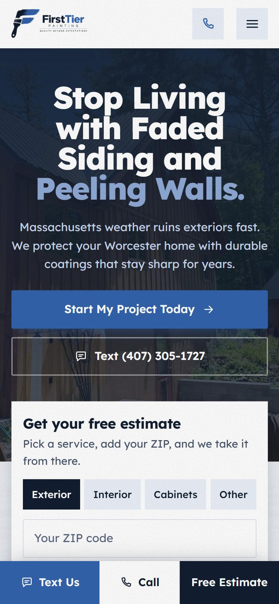

<div align="center">


# First Tier Painting

**Site institucional one page para uma empresa de pintura em Worcester, Massachusetts (EUA).**
Feito para converter tráfego pago em pedidos de orçamento por texto, ligação ou formulário.

[](https://first.escolats.com.br)


<br>



</div>

---

## Sobre o projeto

A First Tier Painting é uma empresa de pintura **operada pelos próprios donos**, com base em Worcester, MA, atendendo Central Massachusetts. O site foi construído para o público que chega pelo Meta Ads no celular: em uma tela, o visitante entende o problema (clima de New England estragando a pintura), vê o processo e já consegue pedir o orçamento.

O conceito visual nasce da **logo**: o pincel em forma de "F" nas cores navy e azul royal. Toda a página é tratada como um **leque de amostras de tinta**, com faixas de cor sólidas, bandas de rótulo com códigos como `FT-500 Tier Blue` e um furo de rebite, igual a uma cartela de cores de verdade.

<table>
  <tr>
    <td width="68%"></td>
    <td width="32%"></td>
  </tr>
  <tr>
    <td align="center"><sub>Casa 3D repintada conforme o scroll</sub></td>
    <td align="center"><sub>Mobile com barra fixa de contato</sub></td>
  </tr>
</table>

## Destaques

| | Recurso | Como funciona |
|---|---|---|
| 🏠 | **Casa 3D (Three.js)** | Uma casa colonial de New England passa por quatro estados conforme o scroll: desgastada com neve, lavada, com primer e pintada. O visitante troca a cor da fachada nas amostras. |
| 🖌️ | **Pincel no scroll** | Na seção "How It Works", um pincel pinta os três passos com borda de cerdas. Tudo fica pintado quando a faixa chega ao meio da tela. |
| 📝 | **Orçamento em 3 passos** | Formulário com serviço, ZIP, prazo e contato preferido. O formulário rápido do hero já preenche o serviço e o ZIP. |
| 💬 | **Texto em primeiro lugar** | O cliente prefere SMS, então a barra fixa do mobile coloca **Text Us** como ação principal. |
| 🛡️ | **Antispam** | Campo oculto, tempo mínimo na página, interação real, bloqueio de links e espera de 1 minuto entre envios, mais o filtro do Formspree. |
| 🖼️ | **Galeria com zoom** | Mosaico de fotos reais com visualização em tela cheia, navegável pelo teclado. |
| 📱 | **Responsivo revisado** | Testado em 375, 390, 768, 1024, 1366 e 1920 px, além de celular deitado. |
| ♿ | **Acessibilidade** | Contraste WCAG AA, áreas de toque de 44 px, foco visível e versão sem animação para `prefers-reduced-motion`. |

## Identidade visual

<table>
  <tr>
    <td align="center"><br><b>Worcester Navy</b><br><code>#121E30</code></td>
    <td align="center"><br><b>Elm Park</b><br><code>#1A3360</code></td>
    <td align="center"><br><b>Tier Blue</b><br><code>#3363AC</code></td>
    <td align="center"><br><b>Shore</b><br><code>#8FAAD6</code></td>
    <td align="center"><br><b>Harbor Mist</b><br><code>#C9D7EC</code></td>
    <td align="center"><br><b>Frost</b><br><code>#EAF0F8</code></td>
  </tr>
</table>

- **Tipografia:** [Lexend](https://fonts.google.com/specimen/Lexend) para títulos e textos, e [Lexend Zetta](https://fonts.google.com/specimen/Lexend+Zetta) para os códigos de cor, ecoando a tagline espaçada da logo.
- **Nomes de cor:** inspirados em lugares de Worcester (Elm Park, Lake Quinsigamond).
- **Textura:** grão fino de rolo de tinta nas seções e marca d'água do pincel em About, Reviews, FAQ e rodapé.

## Estrutura

```
FIRST-TIER-PAINTING/
├── index.html              # Página única
├── 404.html                # Página de erro (servida em /404)
├── clean-cache.php         # Limpa o cache do navegador (/clean-cache)
├── .htaccess               # URLs limpas, HTTPS, cache, segurança e antispam
├── robots.txt · sitemap.xml · llms.txt · humans.txt
├── site.webmanifest        # PWA: nome, cores e ícones
├── favicon.ico · *.png     # Favicons gerados a partir da logo
├── assets/
│   ├── css/styles.css      # Sistema visual completo
│   ├── js/main.js          # Menu, formulário, galeria e animações (GSAP)
│   ├── js/house3d.js       # Cena 3D da casa (Three.js, carregada sob demanda)
│   ├── js/antispam.js      # Proteção do formulário
│   ├── logo/               # Logos e ícones da marca
│   └── fotos/              # Fotos reais dos projetos do cliente
└── docs/                   # Imagens deste README
```

## Rodando localmente

Não há build. Qualquer servidor estático funciona:

```bash
# com Node
npx serve .

# ou com Python
python -m http.server 5500
```

Depois abra `http://localhost:5500`.

> As regras do `.htaccess` (URLs sem `.html`, página 404, cache) só funcionam em servidor **Apache**. O `clean-cache.php` precisa de PHP.

## Publicação

1. Envie todos os arquivos da raiz para a pasta pública do domínio (`public_html`).
2. Confirme que o HTTPS está ativo; o `.htaccess` redireciona tudo para `https://` e remove o `www`.
3. Depois de cada atualização, abra **`/clean-cache`** para ver a versão nova. Ao alterar CSS ou JS, troque o `?v=20261027` no `index.html` para que todos os visitantes recebam os arquivos novos.

### URLs limpas

| Acesso | Resultado |
|---|---|
| `/index.html` | redireciona para `/` |
| `/404.html` | redireciona para `/404` |
| `/qualquer-coisa` | mostra a página 404 com status 404 |

## Configuração pendente

- [ ] **Formspree:** trocar `YOUR_FORM_ID` em `index.html` (atributo `data-endpoint` do formulário) pelo ID real do formulário.
- [ ] **Reviews:** os três depoimentos são **modelos**. Substituir pelos reviews reais do Google assim que o Google Business Profile estiver ativo.
- [ ] **Licença e seguro:** só usar "Licensed & Insured" depois que os documentos forem emitidos.
- [ ] **HSTS:** ativar a linha `Strict-Transport-Security` no `.htaccess` quando o HTTPS do domínio final estiver confirmado.

### Migração para o domínio definitivo

Trocar `first.escolats.com.br` pelo domínio final em `index.html` (canonical, Open Graph e dados estruturados), `robots.txt`, `sitemap.xml` e `llms.txt`.

O bloqueio de indexação (`X-Robots-Tag: noindex`) vale **apenas** para o host de teste e desliga sozinho no domínio novo.

## Contato do cliente

**First Tier Painting**: Worcester, MA 01607
📱 [(407) 305-1727](tel:+14073051727) · ✉️ [Info@firsttierpainting.com](mailto:Info@firsttierpainting.com) · 📷 [@firsttierpainting](https://www.instagram.com/firsttierpainting/)

---

<div align="center">

Desenvolvido por **[Eu Sou TS](https://eusouts.com.br/)**

</div>
